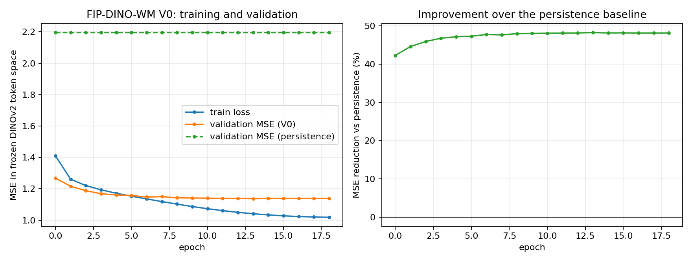

# S3 — FIP-DINO-WM V0 training

Stage: **S3**. Date: 2026-10-24. Branch: `agro-s0-upstream`.

This report is generated from `run_summary.json`, the per-epoch `metrics.jsonl` and the checkpoint metadata by `tools/s3_write_reports.py`.

## 1. What is trained — and what is not

- **Frozen**: DINOv2 ViT-B/14, the same pinned clone and weights as S1 (`7764ea0f912e53c92e82eb78a2a1631e92725fc8`, weights `0b8b82f85de91b424aded121c7e1dcc2b7bc6d0adeea651bf73a13307fad8c73`). It is used to produce the S1/S2 `mainline224_s1-v1` cache; it receives no gradient.
- **Trainable**: the DINO-WM `ViTPredictor` (upstream class) plus a trainable time projection that maps the real `delta_days` into the action channel. A constant proprio placeholder keeps the upstream `concat_dim=1` interface.
- **Not present in V0**: no weather encoder, no physiological subspace, no EMA teacher, no LoRA, no multi-step autoregressive training, no pixel decoder.
- This is therefore a **frozen-DINOv2 feature predictor**, not an I-JEPA/V-JEPA EMA objective. The report does not call it one.

## 2. Data index

| Quantity | Train | Validation |
|---|---|---|
| pairs | 56,139 | 15,175 |
| unique images | 36,631 | 10,858 |
| plots | 1,000 | 380 |

- pair families: `['span7', 'span14']` (S2 tolerance ±2 d); the actual `delta_days` is the model input, not the span name.
- index SHA256: `f6ef1871655277549aba2d883b6f76a5831b7976af90fc74d80206591d884933`
- feature-index SHA256: `158b31dafad13f09cce46ca32abb695e51bb6aff30e6d55878443ae01fd12963`
- time normalisation (train only): {'mean': 10.252854521811932, 'std': 3.6747805386218597, 'min': 5.0, 'max': 16.0, 'n_samples': 56139, 'rule': 'fitted on train split delta_days only; reused for validation/test'}
- **Pilot flag**: `True` — Subset of the official train split (per-year plot sample) plus all validation plots; not the full 2,930 train plots.  Reported as a Pilot, not a full-FIP baseline.

## 3. Model

| Component | Value |
|---|---|
| input | frozen DINOv2 patch tokens `z_a` [B, 256, 768] |
| time input | real `delta_days` [B] |
| predictor | upstream `models.vit.ViTPredictor` |
| predictor depth / heads / mlp | 6 / 16 / 2048 |
| visual / proprio / action width | 768 / 160 / 160 |
| predictor width | 1088 |
| time encoder | 8 sin/cos frequencies → MLP (256) → 10 |
| proprio input | constant zero placeholder (no future phenotype) |
| trainable parameters | 53.88 M |
| output | `z_hat_b` [B, 256, 768] |

Loss: `MSE(z_hat_b, stopgrad(z_b))` on the 256 visual patch tokens only. The future image is never a model input; it only contributes the stop-gradient target. The constant proprio channels receive no loss.

## 4. Optimisation (measured)

| Item | Value |
|---|---|
| device | cuda:0 (NVIDIA RTX A6000) |
| torch | 2.10.0+cu128 |
| AMP | bf16 |
| optimiser | AdamW |
| batch size | 128 |
| steps / epoch | 438 |
| epochs completed | 19 |
| global steps | 8322 |
| wall clock | 57.9 min |
| throughput | 306.49 samples/s |
| peak GPU memory | 14.33 GB |
| best validation MSE | 1.13656 |
| best epoch | 13 |

## 5. Training curve (real epoch logs)

| epoch | train loss | val MSE V0 | val MSE persistence | rel. improvement | cos V0 | cos persistence | epoch s |
|---|---|---|---|---|---|---|---|
| 0 | 1.40973 | 1.26726 | 2.19515 | +42.27% | 0.7556 | 0.6279 | 179.5 |
| 1 | 1.26059 | 1.21626 | 2.19515 | +44.59% | 0.7660 | 0.6279 | 176.2 |
| 2 | 1.22049 | 1.18756 | 2.19515 | +45.90% | 0.7718 | 0.6279 | 175.4 |
| 3 | 1.19338 | 1.16872 | 2.19515 | +46.76% | 0.7758 | 0.6279 | 174.9 |
| 4 | 1.17143 | 1.16018 | 2.19515 | +47.15% | 0.7776 | 0.6279 | 176.1 |
| 5 | 1.15267 | 1.15719 | 2.19515 | +47.28% | 0.7782 | 0.6279 | 176.8 |
| 6 | 1.13524 | 1.14730 | 2.19515 | +47.73% | 0.7803 | 0.6279 | 177.1 |
| 7 | 1.11847 | 1.14995 | 2.19515 | +47.61% | 0.7797 | 0.6279 | 176.6 |
| 8 | 1.10232 | 1.14219 | 2.19515 | +47.97% | 0.7814 | 0.6279 | 178.4 |
| 9 | 1.08668 | 1.14125 | 2.19515 | +48.01% | 0.7816 | 0.6279 | 178.4 |
| 10 | 1.07300 | 1.13983 | 2.19515 | +48.08% | 0.7820 | 0.6279 | 178.1 |
| 11 | 1.06051 | 1.13917 | 2.19515 | +48.11% | 0.7824 | 0.6279 | 179.2 |
| 12 | 1.04970 | 1.13861 | 2.19515 | +48.13% | 0.7825 | 0.6279 | 178.4 |
| 13 | 1.04080 | 1.13656 | 2.19515 | +48.22% | 0.7829 | 0.6279 | 179.3 |
| 14 | 1.03339 | 1.13853 | 2.19515 | +48.13% | 0.7826 | 0.6279 | 177.9 |
| 15 | 1.02748 | 1.13805 | 2.19515 | +48.16% | 0.7827 | 0.6279 | 181.7 |
| 16 | 1.02317 | 1.13881 | 2.19515 | +48.12% | 0.7826 | 0.6279 | 177.4 |
| 17 | 1.02017 | 1.13864 | 2.19515 | +48.13% | 0.7827 | 0.6279 | 178.1 |
| 18 | 1.01830 | 1.13875 | 2.19515 | +48.12% | 0.7826 | 0.6279 | 177.8 |

Per-step logs: `external_data/s3_runs/v0/metrics.jsonl`. All values above are copied from that log.



Regenerate the figure with `python3 tools/s3_make_figures.py`.

## 6. Checkpoint and resume

- best checkpoint: `external_data/s3_runs/v0/checkpoints/best.pt`
- last checkpoint: `external_data/s3_runs/v0/checkpoints/last.pt`
- checkpoint SHA256 (best): `c337fca506e6a7e31fb90fca1f9197033992c2f8054287d76ec69b4c37426414`
- format: `agro-jepa-s3-v0-state-dict-v1` (plain `state_dict`, not a whole-object pickle)
- contents: model, optimizer, scheduler, AMP scaler, epoch, global step, config, train-only delta statistics, manifest id, index SHA256, feature-index SHA256, git commit, metrics
- resume test: **pass** (fresh model + optimizer load reproduces the same prediction)

## 7. Reproduction

```bash
# 1) images (resumable; re-run to close failed downloads)
python3 tools/s3_prepare_images.py --train-plots-per-year 200 --workers 40
# 2) frozen features
CUDA_VISIBLE_DEVICES=1 python3 tools/s3_build_features.py
# 3) frozen train/validation index
python3 tools/s3_build_index.py --config agro_jepa/config/s3_v0.yaml
# 4) training
CUDA_VISIBLE_DEVICES=1 python3 agro_jepa/train/train_v0.py \
    --config agro_jepa/config/s3_v0.yaml --report reports/s3_training.json
# 5) evaluation + acceptance
CUDA_VISIBLE_DEVICES=1 python3 agro_jepa/eval/eval_v0.py \
    --config agro_jepa/config/s3_v0.yaml \
    --checkpoint external_data/s3_runs/v0/checkpoints/best.pt
CUDA_VISIBLE_DEVICES=1 python3 tools/s3_verify.py
```

## 8. Irregular-interval expansion run

Same model, loss and plots; the index adds the S2 true-consecutive pairs (`span7 + span14 + consecutive`).

| Item | Value |
|---|---|
| pairs (train / val) | 81,751 / 21,617 |
| realised delta range | 1–84 d (consecutive median 3 d) |
| epochs completed | 20 |
| global steps | 12760 |
| wall clock | 87.6 min |
| throughput | 310.83 samples/s |
| peak GPU memory | 13.34 GiB |
| best validation MSE | 1.11788 |
| best epoch | 14 |
| checkpoint | external_data/s3_runs/v0_consecutive/checkpoints/best.pt |

E1 for this run is in `reports/s3_v0_results.md` §1.4; its curve is `reports/figures/s3_v0_consecutive_training_curve.png`.

## 9. Open items

1. Pilot scale: 1,000 train plots, all 380 validation plots. Extending to the full 2,930 train plots is a data/acquisition step, not a code change.
2. The time channel is a sinusoidal+MLP projection into the DINO-WM action channel; whether a stronger conditioning (e.g. FiLM) helps is an S4 ablation.
3. No weather or physiology is used in V0, by design; S4 adds the Weather-GRU / GDD / phenotype-anchor baselines.

